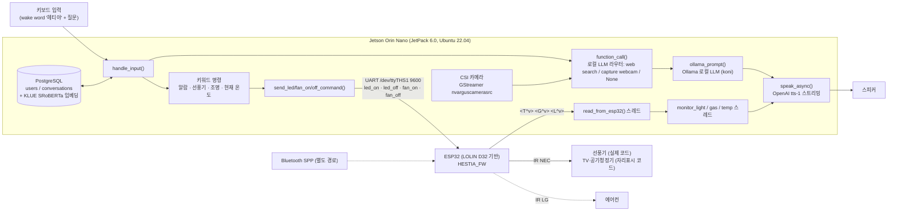

# HESTIA_SW — Jetson Orin Nano 로컬 LLM 대화 · 센서 연동 · 가전 제어 애플리케이션

독거노인용 대화형 홈 어시스턴트 **HESTIA**의 Jetson 측 애플리케이션입니다.
Jetson Orin Nano에서 **Ollama로 로컬 LLM(Llama3 8B Q4_K_M)** 을 구동해 대화하고, UART로 연결된 ESP32에서 올라오는 실내 센서 값에 따라 먼저 말을 걸며, 키워드 명령으로 LED·선풍기 등 가전을 제어합니다. 사용자별 대화 기록은 PostgreSQL에 문장 임베딩과 함께 저장해 관련 대화를 다시 불러옵니다.

> **English summary** — Jetson Orin Nano application of HESTIA, a conversational home assistant for elderly people living alone. The main pipeline (`ollama_chat.py`) runs a local Llama3 8B Q4_K_M model through Ollama, keeps per-user conversation memory in PostgreSQL with sentence embeddings, receives sensor packets from an ESP32 over UART (`/dev/ttyTHS1`, 9600 bps) and sends appliance commands (LED / fan) back. `main_chat.py` is an earlier voice-input version that used the OpenAI GPT-4o API and is kept for comparison.

🎬 **데모 영상:** [HESTIA 시연 (YouTube)](https://www.youtube.com/watch?v=fuKamIi-SM0)

## 1. 시스템 아키텍처



- **대화 LLM과 라우터는 로컬**(Ollama)에서 실행됩니다. TTS(OpenAI `tts-1`), 웹캠 이미지 설명(Gemini 1.5 Flash), 응답 이미지 생성·GUI 표시(DALL·E 3), 웹 검색(Google Custom Search), 날씨(OpenWeatherMap)는 **클라우드 API**를 사용합니다.
- 가전 제어는 LLM 도구 호출이 아니라 **문자열 키워드 매칭**(예: "선풍기 틀어줘")으로 UART 명령을 보냅니다.
- 에어컨 IR(LG 프로토콜)은 펌웨어의 Bluetooth 명령 경로에만 있고, 이 애플리케이션의 UART 경로에는 없습니다.

## 2. 실행 버전

| 파일 | 입력 | 대화 LLM | 비고 |
|---|---|---|---|
| **`ollama_chat.py`** | 키보드 (`헤티야 ...`) | **Ollama 로컬 모델 `koni`** (HESTIA_AI_Model의 Llama3 8B Q4_K_M Modelfile로 생성) | **최종 로컬 LLM 파이프라인** |
| `main_chat.py` | 마이크 (Google 웹 음성 인식 `recognize_google`, ko-KR) | OpenAI GPT-4o API | 이전 클라우드 API 버전 / 비교용 |
| `main_chat_cam.py` | 마이크 | OpenAI GPT-4o API | `main_chat.py` + 카메라 얼굴 추적 서보 결합 |
| `face_tracking.py` | 카메라 | – | Haar 얼굴 검출 + Jetson GPIO PWM 1축(pan, BOARD 15번 핀) 서보 단독 데모 |

## 3. HW / SW 스택

| 구분 | 내용 (코드 기준) |
|---|---|
| 보드 | Jetson Orin Nano 8GB, JetPack 6.0 (L4T 36.3.0) |
| 언어/런타임 | Python 3.11 (conda), `threading` 멀티스레드, tkinter 전체화면 GUI |
| LLM | Ollama `koni` (로컬) — `main_chat.py`는 GPT-4o |
| 기억 | PostgreSQL(psycopg2) + `bespin-global/klue-sroberta-base-continue-learning-by-mnr` 임베딩, 코사인 유사도로 관련 대화 5개 회수 |
| MCU 링크 | pyserial `/dev/ttyTHS1`, 9600 bps, 줄 단위 ASCII (`\n`) |
| 카메라 | CSI 카메라, GStreamer `nvarguscamerasrc` 파이프라인 |

## 4. 주요 모듈 (`ollama_chat.py`)

| 모듈 | 함수 | 설명 |
|---|---|---|
| UART 수신 | `read_from_esp32()` | `<T^v>/<G^v>/<L^v>` 패킷 파싱, 디코드 오류 시 `errors='ignore'` 재시도 |
| 센서 이벤트 | `monitor_light/gas/temp()` | 조명 꺼짐(1→0)·가스 감지(0→1) 시 안내 발화, 26 °C 이상이면 30초 뒤 선풍기 제안 (1시간 후 재무장) |
| 가전 명령 | `send_led_on/off_command()`, `send_fan_on/off_command()` | `"fan_on\n"` 등 문자열 송신 |
| 라우터 | `function_call()` | 시스템 프롬프트로 로컬 LLM이 `perform web search` / `capture webcam` / `None` 중 하나를 고르게 하는 방식 (파인튜닝 없음) |
| 기억 | `save_conversation()`, `load_relevant_conversation_embeddings()` | 질문·응답 결합 임베딩(질문 0.8 / 응답 0.2 가중) 저장·검색 |
| 비활동 감지 | `check_inactivity()` | 5분 무응답 시 웹캠으로 상태 확인 후 말 걸기 |
| 알람 | `parse_alarm_time_and_set()`, `cancel_alarm()` | 1회/매일 반복 알람 |

## 5. 설치 & 실행

```bash
git clone https://github.com/MJU-HESTIA/HESTIA_SW.git && cd HESTIA_SW
conda create -n hestia python=3.11.6 opencv=4.9.0 cuda=12.2 pyaudio=0.2.11
conda activate hestia
pip install -r requirements.txt
cp .env.example .env              # 키 이름만 있는 템플릿 — 값은 직접 입력, 커밋 금지
sudo usermod -aG dialout $USER    # UART 접근 권한 (재로그인 필요)

# 로컬 LLM 준비 (HESTIA_AI_Model 참고)
ollama create koni -f ../HESTIA_AI_Model/Modelfile   # GGUF 파일은 저장소에 포함되지 않음
python ollama_chat.py             # 최종 로컬 LLM 버전
# python main_chat.py             # 이전 GPT-4o 음성 버전
```

PostgreSQL 테이블은 코드의 SQL에서 다음 구조를 가정합니다(생성 스크립트는 저장소에 없음):
`users(id, username UNIQUE)`, `conversations(id, user_id, message, response, combined_embedding)`.

## 6. 테스트 / 디버깅

- 저장소에 자동화 테스트(pytest 등)는 없습니다.
- `ollama_chat.py`는 키보드 입력으로 동작하므로 마이크 없이 LLM·UART 명령·DB 경로를 점검할 수 있습니다.
- 코드에 주석 처리된 `change_light/gas/temp()` 스레드를 켜면 센서 값을 강제로 바꿔 선제 발화 로직을 하드웨어 없이 확인할 수 있습니다.

## 7. 파일 구조

```
ollama_chat.py      # 최종: 로컬 LLM(Ollama) 버전
main_chat.py        # 이전: 음성 입력 + GPT-4o
main_chat_cam.py    # main_chat + 카메라 얼굴 추적 서보
face_tracking.py    # 얼굴 추적 1축 서보 단독 데모
start_hestia.sh     # conda 환경 활성화 후 main_chat.py 실행 (경로 수정 필요)
start_image.jpg     # GUI 시작 화면 이미지
requirements.txt, .env.example, .gitignore
```

## 8. 한계 및 개선 계획

- 1,000줄 이상 단일 스크립트와 변형 버전들 → `uart / sensors / llm / tts / memory` 모듈 분리
- 가전 제어가 키워드 매칭 → 라우터 선택지에 기기 제어 추가
- UART 프로토콜이 줄 단위 문자열 → 프레이밍·오류 검출 보강, `in_waiting` 바쁜 대기 개선
- TTS·비전은 여전히 클라우드 API 의존

## 9. My role

**이승석** — 전체 시스템 통합, Jetson 측 소프트웨어(이 저장소), ESP32 펌웨어(HESTIA_FW), IR 가전 제어.

- Jetson ↔ ESP32 UART 연동: 센서 패킷 파서와 수신 스레드, LED·선풍기 명령 송신 (`read_from_esp32`, `send_*_command`)
- 센서 값 기반 선제 발화(조명·가스·온도 모니터 스레드)와 비활동 감지
- Ollama 로컬 LLM 연동(`ollama_chat.py`)과 프롬프트 기반 라우터(`function_call`)
- PostgreSQL + 문장 임베딩 대화 기억, TTS 스트리밍 재생, Jetson CSI 카메라 GStreamer 캡처
- 카메라 얼굴 추적 1축 서보 데모(`face_tracking.py`)

## 관련 저장소

[HESTIA_FW](https://github.com/MJU-HESTIA/HESTIA_FW) · [HESTIA_AI_Model](https://github.com/MJU-HESTIA/HESTIA_AI_Model) · [HESTIA_PCB](https://github.com/MJU-HESTIA/HESTIA_PCB) · [HESTIA_VISION](https://github.com/MJU-HESTIA/HESTIA_VISION) · [HESTIA_App](https://github.com/MJU-HESTIA/HESTIA_App)
